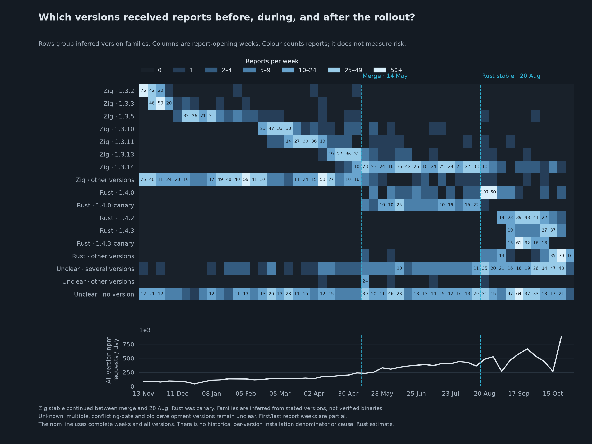
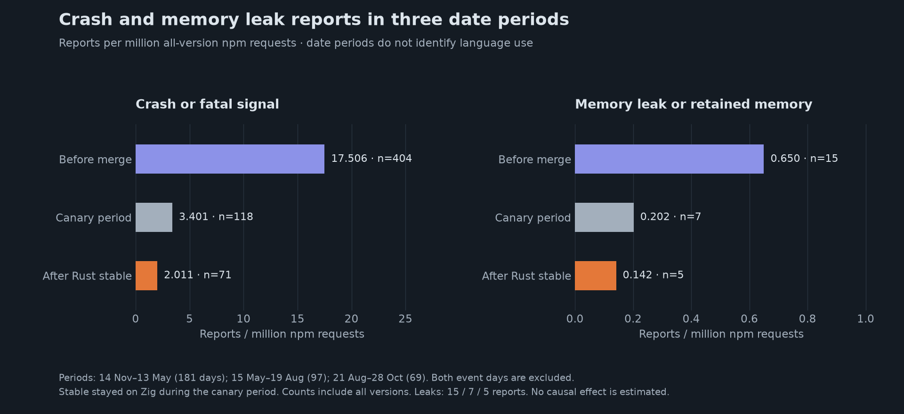
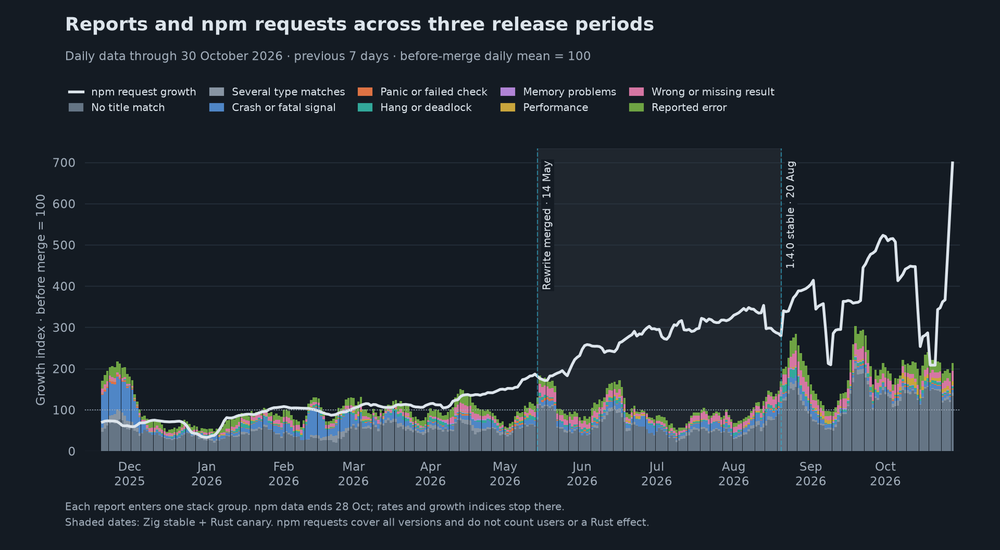
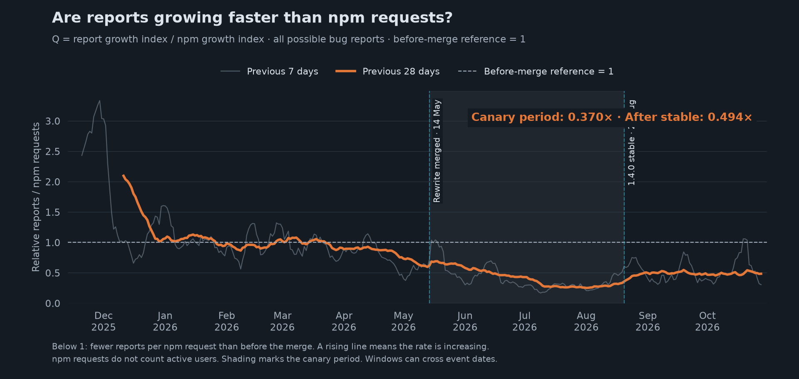
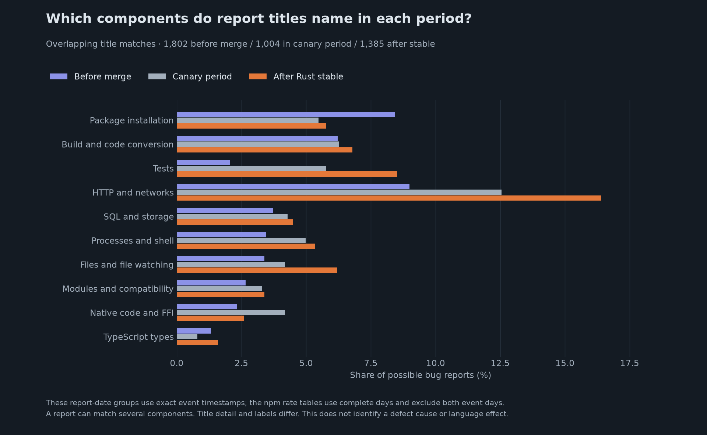
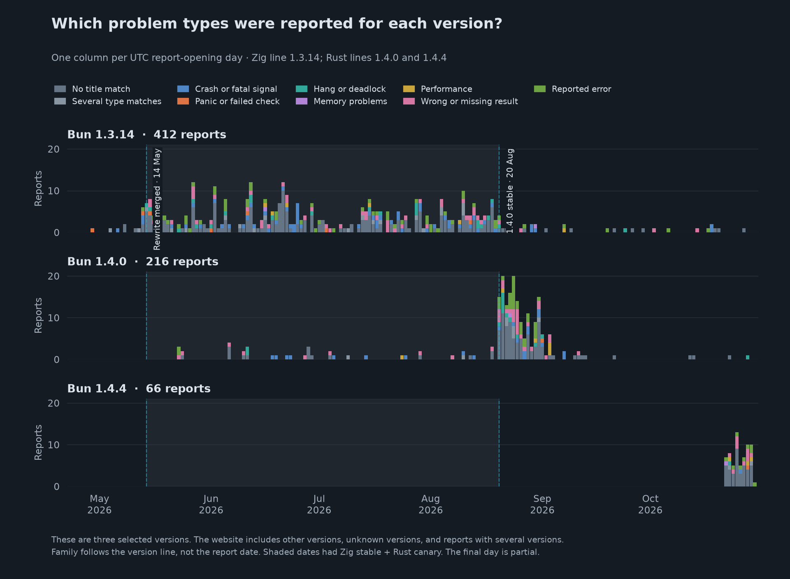
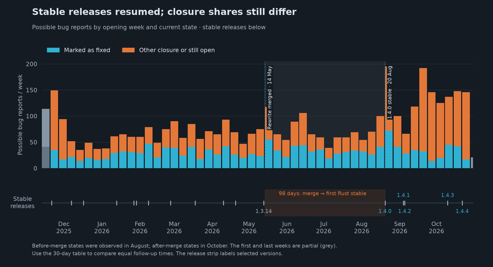

# Bun's rewrite: reports, versions, and release periods

Bun merged [PR #30412](https://github.com/oven-sh/bun/pull/30412) on **14 May 2026**. Rust reached stable in [Bun 1.4.0 on 20 August](https://bun.com/blog/bun-v1.4). Between these dates, **stable stayed on Zig; Rust was canary**. Merge was not a migration date for all users.

This fork extends [Aleksandr Smyshliaev's original study](https://github.com/asmyshlyaev177/bun-rust-rewrite-analysis) through **30 October 2026**. It separates **report date**, **stated version**, and **inferred version family**. It does not estimate a causal effect of Rust.



**[Open the interactive report](https://bun-rust-analysis-ilyagulya.netlify.app/)** · [Versions and families](https://bun-rust-analysis-ilyagulya.netlify.app/#p3-family-map) · [Three-period rates](https://bun-rust-analysis-ilyagulya.netlify.app/#p3-safety)

The website and seven figures use the same saved report snapshot. [Download the HTML](https://raw.githubusercontent.com/IlyaGulya/bun-rust-rewrite-analysis/master/index.html) for offline use.

## What the evidence supports

- **Three date periods have different report patterns.** The canary period includes reports about Zig stable. The after-stable period also includes old Zig versions.
- **The measures do not move together.** After stable, reports per npm request are higher than during the canary period. Crash and explicit leak rates are lower. Broad memory-report rates are higher.
- **Counts do not establish language quality.** A title match does not confirm a defect. npm requests do not count active users. Versions and report dates do not prove the cause of a problem.

The earlier two-period headlines combined the canary and after-stable periods. They could suggest a Rust improvement before Rust reached stable. Those headlines have been removed.

## Three calendar periods

The rate comparison uses complete UTC days with both report and npm data. It excludes **14 May and 20 August**, because each event occurred partway through its day. It also excludes partial report days and unpublished npm dates.

| Period | Complete dates | Days | Possible bug reports | npm requests | Reports per million requests |
| --- | --- | ---: | ---: | ---: | ---: |
| Before merge | 2025-11-14–2026-05-13 | 181 | 1,772 | 23,077,916 | 76.78 |
| Canary period | 2026-05-15–2026-08-19 | 97 | 985 | 34,698,894 | 28.39 |
| After Rust stable | 2026-08-21–2026-10-28 | 69 | 1,338 | 35,306,720 | 37.90 |

These are **all-version date groups**, not Zig and Rust user groups. The full report-date groups contain **1,802 / 1,004 / 1,385** possible bug reports. They use exact event timestamps and include boundary-day reports. The complete-day rate table uses fewer reports.

Issue data was collected at **30 October, 09:20:14 UTC**. npm data ends on **28 October**. The first issue day, final issue day, and final npm gap are not complete paired observations.

## Versions and language families

The map places versions on rows and report-opening weeks on columns. All rows use the same colour scale. The npm line below uses the same dates, across all versions. It provides context; it is not a version-specific denominator.

[Use the map](https://bun-rust-analysis-ilyagulya.netlify.app/#p3-family-map) to filter the family or problem type. Show the 12 most-reported versions plus remaining groups, or every stated version. Select a cell to open the daily chart for that version and week.

**Family is inferred from the stated version line.** It is not a verified binary classification:

- **Zig:** versions before 1.4. Old canary, dev, and debug strings after merge remain unclear.
- **Rust:** versions from 1.4 stated after merge. Plain `1.4.0` does not distinguish stable from canary.
- **Unclear:** no usable version, several versions, conflicting dates, or uncertain development versions. We do not assign these reports by date.

| Inferred stated-version family | Before merge | Canary period | After Rust stable |
| --- | ---: | ---: | ---: |
| Zig version line | 1,468 | 400 | 42 |
| Rust version line | 0 | 199 | 781 |
| Unclear family | 334 | 405 | 562 |

These full snapshot counts total **4,191 reports**: **1,910 Zig-line**, **980 Rust-line**, and **1,301 unclear**. The unclear group includes **857 with no usable version**, **416 with several versions**, and **28 with uncertain date/channel evidence**. Before-merge reports include a Rust-line version with a conflicting date; it stays unclear.

The parser first reads the Bun version field. It then checks explicit Bun-version text. Base versions must match saved official releases. Later text edits and rejected new canary bases can affect this inference. [Per-report version evidence](part3/data/versions.jsonl) · [Map data](part3/data/family-matrix.json).

## Crashes and memory leaks



Rates below are reports per million **all-version** npm requests. Each cell shows **report count / rate**.

| Report type | Before merge: count / rate | Canary period: count / rate | After stable: count / rate | Stable vs canary rate |
| --- | ---: | ---: | ---: | ---: |
| All possible bug reports | 1,772 / 76.783 | 985 / 28.387 | 1,338 / 37.896 | +33.5% |
| Crash reports | 404 / 17.506 | 118 / 3.401 | 71 / 2.011 | -40.9% |
| Memory leak reports | 15 / 0.650 | 7 / 0.202 | 5 / 0.142 | -29.8% |
| Memory keyword reports | 27 / 1.170 | 10 / 0.288 | 14 / 0.397 | +37.6% |

The lower crash rate does not establish a Rust effect. A substantial decline happened before Rust stable. The all-report and broad memory rates are higher after stable than in the canary period. The leak counts are only **15 / 7 / 5**. Those samples are too small to carry a strong quality claim.

The leak rule requires explicit memory retention text. High memory use, OOM alone, growing files, and file-descriptor leaks do not meet it. The crash rule can match unrelated text such as crash-report metadata. Several reports can describe one defect. The HTML links all **27 leak-title matches** in the three complete-day periods.

Adding up to 2,500 body characters gives a separate text check:

| Report type | Before merge: count / rate | Canary period: count / rate | After stable: count / rate | Stable vs canary rate |
| --- | ---: | ---: | ---: | ---: |
| All possible bug reports | 1,772 / 76.783 | 985 / 28.387 | 1,338 / 37.896 | +33.5% |
| Crash reports | 571 / 24.742 | 184 / 5.303 | 121 / 3.427 | -35.4% |
| Memory leak reports | 29 / 1.257 | 9 / 0.259 | 7 / 0.198 | -23.6% |
| Memory keyword reports | 70 / 3.033 | 30 / 0.865 | 32 / 0.906 | +4.8% |

Body mentions can be unrelated or negated. Old and new excerpt formats differ. This check does not validate the classes. [Rules, dates, and calculations](part3/SAFETY-2026-10-30.md).

## Download context



The optional growth view gives each series its own before-merge daily mean of 100. This reference is a date-period average. It does not describe the number of Rust users. The interactive daily chart defaults to raw counts. Select a stated version or a version family for detail.

| Complete-day period | Reports/day | npm requests/day |
| --- | ---: | ---: |
| Before merge | 9.79 | 127,502 |
| Canary period | 10.15 | 357,721 |
| After Rust stable | 19.39 | 511,692 |

**June to October is a different comparison.** June averaged **348,054 npm requests/day**. The mean for 1–28 October was **533,390/day**, about **1.53×**. Comparing all days before merge with all days after merge gives a different factor. Neither factor measures user growth.

npm includes repeated downloads and automated jobs. Direct installers, embedded runtimes, Homebrew, and Docker can be absent. We have no historical daily installation counts by Bun version or language family. We therefore do not show “bugs per Zig/Rust installation”. [Download sources and limits](part3/POPULARITY-SOURCES.md).

## Relative report rate



```text
Q = current report/request rate / before-merge period rate
  = report growth index / npm growth index
```

At **Q = 1**, the rate equals the before-merge reference. Below 1, it is lower. A rising Q means reports grow faster than npm requests over that interval. It can rise while still below 1.

For all reports, the canary-period rate is **0.370×** the reference. The after-stable rate is **0.494×**. The latter is **33.5% higher than the canary-period rate**. These date-period ratios do not measure a language effect. Rolling windows can cross event dates; period summaries exclude both event days.

## Components and daily version detail



Titles can name several components. These groups overlap. The same rules apply in all periods, but title detail and labels can change. The [36-report review](part3/CLASSIFICATION-AUDIT.md) found wrong and missed matches. It does not measure overall classifier accuracy.



The daily stack puts each report in one group: one matched type, several types, or no match. The map's problem-type filter uses direct title matches, so a crash can count even when its title matches other types too. The map's leak filter uses the separate explicit-leak rule.

## Releases and follow-up



Bun 1.4.0 reached stable on **20 August**, 98 calendar days after merge. Patches followed on **4 September (1.4.1)**, **5 September (1.4.2)**, **10 October (1.4.3)**, and **22 October (1.4.4)**. [Release-source checks](part2/SOURCES-2026-10-30.md).

| Report-date group | Reports at least 30 days old | Marked as fixed within 30 days | Share |
| --- | ---: | ---: | ---: |
| Before merge | 1,802 | 478 | 26.5% |
| Canary period, all builds | 1,004 | 297 | 29.6% |
| After Rust stable, all builds | 796 | 192 | 24.1% |

“Marked as fixed” means GitHub currently records `closed` with reason `completed`. It does not prove a fix shipped. Before-merge states were observed in August; later states were observed in October. Reopen history is incomplete. These shares do not isolate a language effect. [Follow-up details](part2/UPDATE-2026-10-30.md).

## Limits

Report dates, stated version lines, and active runtime use are different measures. This study can show when reports arrived and which versions their text names. It cannot establish that Rust caused fewer or more defects.

The periods contain different releases, features, users, and follow-up times. Older releases have more time to receive reports. Text and labels can change after filing. Reports can be duplicated, misclassified, or missing. Downloads do not count users. Unknown versions remain visible rather than being assigned by date.

The [original August source text](archive/README-2026-08-10.md) and [original HTML](archive/report-2026-08-10.html) remain historical evidence. Their claims apply to that date.

## Rebuild and verify

Use Python 3, Node.js, and pnpm:

```bash
pnpm install --frozen-lockfile
pnpm run rebuild
pnpm run verify
pnpm run site
```

Use Python 3.12 or later for README figures:

```bash
python3 -m venv .venv-readme
.venv-readme/bin/pip install -r requirements-readme.txt
.venv-readme/bin/python scripts/render-readme-charts.py
```

<details>
<summary>Source files and publishing</summary>

- [Current HTML](index.html), [seven figures](assets/readme/), and their [manifest](assets/readme/manifest.json).
- [Type and family rules](part3/README.md), [crash/leak calculations](part3/SAFETY-2026-10-30.md), and [npm/GitHub sources](part3/POPULARITY-SOURCES.md).
- [Saved inputs and audit data](part3/data/), [original data](data/), and [writing rules](WRITING.md).
- [Infographic design and reading guide](part3/INFOGRAPHIC.md).

`pnpm run refresh` collects new reports, npm counts, and star history. It can change old counts when reports change. Review the README and figures after a refresh. GitHub asset counters have separate observation dates.

Run the original checks from `scripts/`:

```bash
(cd scripts && python3 09-verify.py)
```

A GitHub push does not publish Netlify. After review and verification:

```bash
pnpm run site
pnpm --package=netlify-cli@24.0.1 dlx netlify deploy --site bun-rust-analysis-ilyagulya --prod --no-build --dir=dist
```

The web package contains the current report, original report, and license. Local settings and scratch work are ignored.

</details>

## Credits and license

**Aleksandr Smyshliaev** wrote the original study. This fork adds the October data, text rules, version-family map, and three-period comparisons. The code and report use the [MIT license](LICENSE). Issue authors retain copyright in their text. [CITATION.cff](CITATION.cff) provides citation details.
